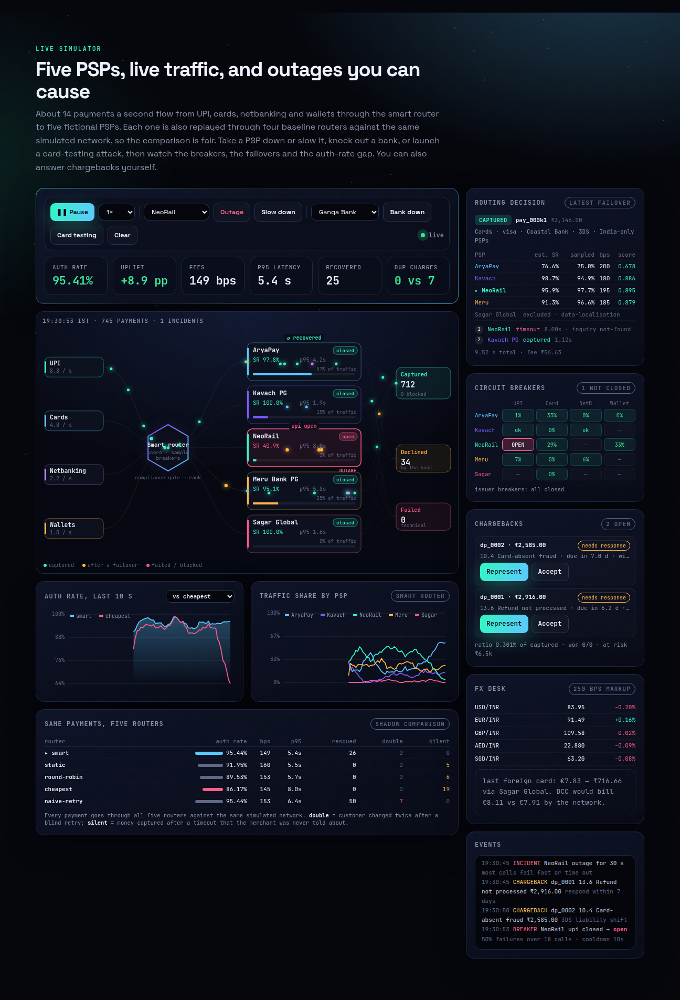
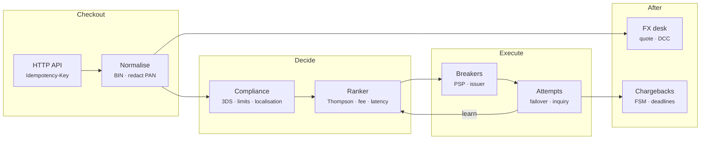
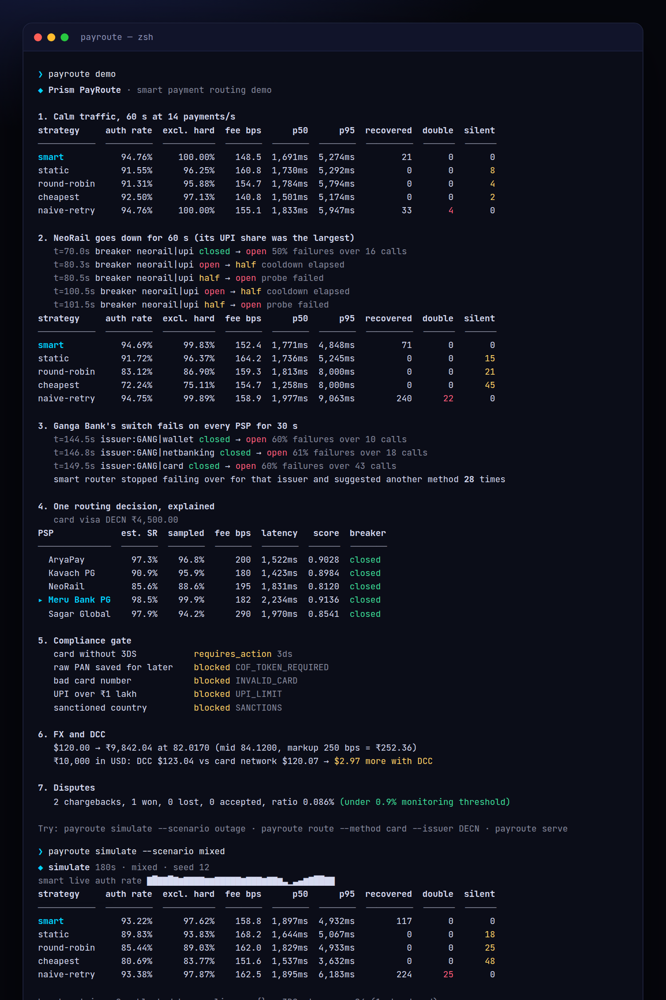
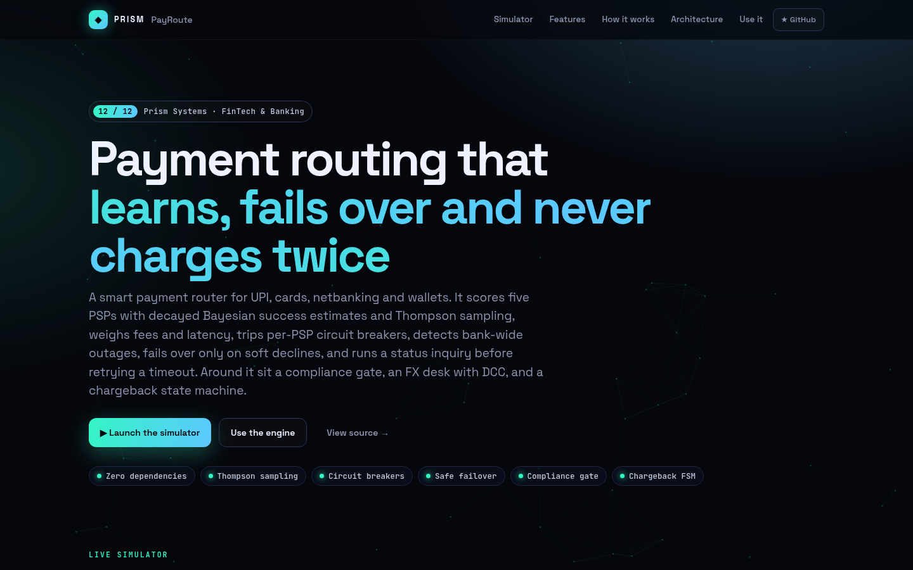
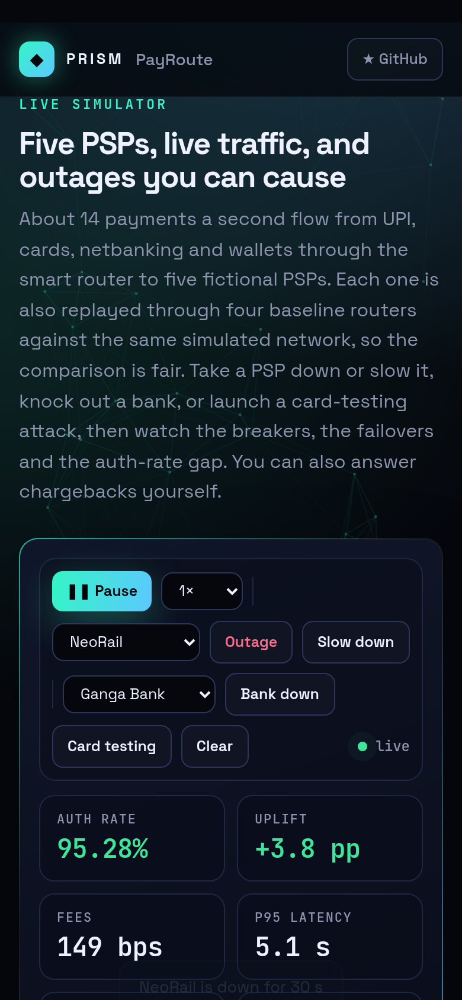

<!-- Prism Systems 12/12 -->
<p align="center">
  
</p>

<p align="center">
  
</p>

<p align="center">
  <a href="https://github.com/krishyaa06/prism-payroute/actions/workflows/ci.yml"></a>
  <a href="https://krishyaa06.github.io/prism-payroute/"></a>
  
  
  
  <a href="LICENSE"></a>
</p>

<p align="center">
  <a href="https://krishyaa06.github.io/prism-payroute/"><b>Live simulator</b></a> ·
  <a href="docs/ARCHITECTURE.md"><b>Architecture</b></a> ·
  <a href="docs/USAGE.md"><b>Docs</b></a> ·
  <a href="#-quick-start"><b>Quick start</b></a>
</p>

<p align="center">
  <a href="https://krishyaa06.github.io/prism-payroute/"></a>
</p>


## ⚡ Overview

Indian merchants usually connect several payment gateways, because any one of them will have bad minutes: a UPI switch slows down, a bank's ACS times out, a PSP has a partial outage. Routing every payment to the gateway most likely to succeed right now, without paying too much and without charging anyone twice, is worth whole percentage points of revenue. Prism PayRoute is a complete, tested model of that decision and everything around it.

## ✨ Features

| | Feature | Details |
| :-: | --- | --- |
| ◎ | **Learns success rates** | Success and failure counts per PSP × method × issuer decay with a 2-minute half-life and borrow a prior from the PSP × method level, so a new combination starts sensible and an old outage is forgotten. |
| ⚄ | **Thompson sampling** | The router ranks PSPs on a sample from each posterior rather than the mean. Uncertain PSPs get some traffic, and well-known bad ones get almost none. |
| ₹ | **Cost and latency aware** | Score = sampled success − fee ratio − latency penalty, with tunable weights. Fees include amex surcharges and cross-border uplift, all in exact integer paise. |
| ⏻ | **Circuit breakers** | A rolling 30 s window per PSP × method. When failures pass 50% over at least 12 calls the breaker opens. After the cooldown, a few probes decide whether it closes or reopens with a doubled cooldown. |
| 🏦 | **Issuer outage detection** | If the failure code says the bank is down, the PSP isn't blamed. A separate issuer breaker limits attempts to one and suggests another payment method instead of retrying. |
| ↺ | **Safe failover** | Only soft declines are retried, within an attempt limit and a 15 s budget. On a timeout the router asks the PSP for the payment status first, and if it was captured it stops. That is why the smart router never double-charges. |
| ⚖ | **Compliance gate** | Checks for sanctions, Luhn and BIN, card-on-file tokenisation, 3DS/AFA step-up, e-mandate and UPI limits, data localisation for domestic payments, and per-instrument velocity. Each block returns a code and a reason. |
| ⇄ | **FX, DCC and disputes** | Firm FX quotes with markup and expiry, a DCC versus card-network comparison, and a chargeback state machine with deadlines, evidence scoring, pre-arbitration and 3DS liability shift. |

## 🏗️ Architecture



### How it works

1. **Normalise** — Validate the method, currency and amount (exact minor units), look up the BIN, and redact the card number so it is never stored.
2. **Gate** — Compliance blocks, asks for 3DS/AFA, or restricts the payment to PSPs that store data in India.
3. **Rank** — Eligible PSPs are scored from a Thompson sample minus fee and latency. Breaker state and merchant rules are applied, and every row records why it was ranked or excluded.
4. **Attempt** — Try the best PSP. Success ends it, a hard decline ends it, and a soft decline fails over. A timeout triggers a status inquiry first.
5. **Learn** — Only technical outcomes update the estimates and breakers. Issuer-wide failures feed the issuer breaker, and hard declines teach nothing about the PSP.

More detail in [docs/ARCHITECTURE.md](docs/ARCHITECTURE.md).

## 🚀 Quick Start

**Try it in the browser:** [https://krishyaa06.github.io/prism-payroute/](https://krishyaa06.github.io/prism-payroute/), no install needed.

```bash
# CLI, no install
npx github:krishyaa06/prism-payroute --help

# add the engine to a project
npm install github:krishyaa06/prism-payroute
```

### JavaScript API

```js
import { Gateway, Router, Network, Platform } from "prism-payroute";

const gw = new Gateway({ router: new Router({ strategy: "smart", costWeight: 1, latencyWeight: 0.3 }) });

// Dry run: compliance + every PSP's score, or why it was excluded
gw.route({ method: "card", amount: "2499.00", threeDS: true, card: { pan: "4111111111111111" } });

// Real attempt with idempotency: same key + same body replays, a different body is a 409
const r = gw.pay({ method: "upi", amount: "499", vpa: "asha@oksahy" }, "order-1042");
r.status;     // "captured" | "declined" | "failed" | "blocked" | "requires_action"
r.attempts;   // [{ psp, n, code, latency, inquiry? }]

// Compare routers on identical traffic and incidents
const P = new Platform({ seed: 12 });
P.run(60); P.outage("neorail", { secs: 60 }); P.run(60);
P.report().strategies.smart.authRate;  // vs .cheapest, .static, .round-robin, .naive-retry

gw.fx.quote(12000, "USD", "INR");      // firm quote with markup and expiry
gw.disputes.act(id, "represent", { evidence: ["delivery", "comms"] });
```

| Export | What it does |
|---|---|
| `new Router({ strategy, costWeight, latencyWeight, explore, failover, breaker, inquiry, maxAttempts, budgetMs, rules })` | Routing engine; strategies `smart`, `static`, `round-robin`, `cheapest`, `naive-retry` |
| `.plan(payment, now, { domesticOnly })` | Ordered candidates plus a row per PSP with `sr`, `sample`, `fee`, `lat`, `score`, `state` or `excluded` |
| `.process(payment, network, now, opts)` | Attempts with failover and inquiry → `{ status, psp, code, attempts, latency, fee, recovered, duplicate? }` |
| `Stats` · `Breaker` · `betaSample` | Decayed Beta posteriors, rolling-window circuit breaker, Beta sampler |
| `new Network({ seed, timeoutMs, lateCapture })` · `.incident({ psp, issuer, method, kind, from, until })` | Deterministic ground-truth PSP model with outages, degradation and issuer failures |
| `new Compliance(opts).check(payment, now)` · `luhn` · `binLookup` · `maskPan` | Pre-route gate → `{ ok, code, reason, require, domesticOnly }` |
| `new FX({ markupBps, ttl }).quote / execute / dcc / convert` | FX desk |
| `new Disputes({ day, respondDays }).open / act / tick / summary` | Chargeback state machine |
| `new Gateway(opts).route / pay / dispute` | Facade with validation and idempotency |
| `new Platform({ seed, rate })` | Synthetic traffic + shadow routers used by the simulator and CLI |
| `createServer(gateway)` from `src/node/server.js` | HTTP API |

### CLI

```bash
$ npx github:krishyaa06/prism-payroute demo
$ npx github:krishyaa06/prism-payroute simulate --scenario mixed --seconds 180
$ npx github:krishyaa06/prism-payroute route --method card --issuer DECN --amount 4500
$ npx github:krishyaa06/prism-payroute fx --from USD --to INR --amount 120
$ npx github:krishyaa06/prism-payroute dispute
$ npx github:krishyaa06/prism-payroute serve --port 8790
```

<p align="center"></p>

| Command | Description |
|---|---|
| `payroute demo` | Calm traffic, a PSP outage, a bank outage, one decision explained, compliance, FX and disputes |
| `payroute simulate [--scenario calm\|outage\|degrade\|issuer\|mixed --seconds 180 --seed 12]` | All five routers on identical traffic |
| `payroute route [--method --amount --currency --issuer --network --pan --no-3ds]` | Explain one routing decision |
| `payroute fx [--from USD --to INR --amount 100 --markup 250]` | Quote and DCC comparison |
| `payroute dispute` | Walk the chargeback state machine |
| `payroute card <pan>` · `payroute psps` · `payroute strategies` | Luhn/BIN, catalog |
| `payroute bench [--n 100000]` | Planning and processing throughput |
| `payroute serve [--port 8790]` | HTTP API |

## 📸 Screenshots

<table>
  <tr>
    <td width="68%"></td>
    <td width="32%"></td>
  </tr>
</table>

## 🧠 Design Decisions

- **Learn only from what the PSP controls.** Hard declines come from the customer's bank account, and issuer-wide failures come from the bank. Neither should move a PSP's score or breaker.
- **Hierarchical priors.** A fine-grained key (PSP × method × issuer) is shrunk towards its parent (PSP × method), so sparse combinations borrow strength and dense ones speak for themselves.
- **Sample, don't argmax.** Thompson sampling keeps exploration proportional to uncertainty. A PSP that recovered after an outage gets traffic back on its own.
- **Timeouts are not failures.** A timeout means "unknown", so the router asks before it retries. The `naive-retry` baseline exists to show what happens without that step.
- **Shadow comparison.** Outcomes are a pure function of (seed, payment, PSP, attempt, incidents), so every router faces the same world, and the numbers in the simulator are a fair comparison rather than separate random runs.
- **Explainable by default.** Every plan returns one row per PSP with its estimate, sample, fee, latency, score and breaker state, or the reason it was excluded.

## 🏭 Production Notes

The routing logic, breakers, compliance rules, FX and dispute state machine are complete and tested. The PSPs, fees and success rates are fictional. A production deployment also needs:

- Real PSP adapters (auth, capture, refund, status inquiry, webhooks) with signature verification and per-PSP idempotency keys.
- Shared state for statistics and breakers (Redis or an in-process gossip layer) so every router instance sees the same health.
- A durable payment state machine (created → authorised → captured → settled → refunded) with an outbox, and reconciliation against PSP settlement files.
- PCI DSS scope control: a vault or network tokens so raw card numbers never reach this service, plus RBI tokenisation and data-localisation reviews by compliance counsel.
- Live FX rates with a rate-lock policy, and dispute evidence upload to each network's portal.
- Guardrails for experiments: minimum traffic per PSP for contract volumes, and an offline policy evaluation before changing weights.

## 📁 Project Structure

```text
prism-payroute/
├── assets/
│   └── logo.svg
├── bin/
│   └── payroute.js
├── css/
│   └── app.css
├── docs/
│   ├── ARCHITECTURE.md
│   └── USAGE.md
├── js/
│   └── app.js
├── src/
│   ├── lib/
│   │   ├── cli.js
│   │   ├── hash.js
│   │   └── rng.js
│   ├── node/
│   │   └── server.js
│   ├── compliance.js
│   ├── disputes.js
│   ├── gateway.js
│   ├── index.js
│   ├── money.js
│   ├── psp.js
│   ├── router.js
│   └── sim.js
├── test/
│   └── payroute.test.js
├── .gitignore
├── LICENSE
├── README.md
├── index.html
└── package.json
```

## 🧪 Tests

```bash
npm test
```

The test suite uses the built-in `node:test` runner, so there is nothing to install. CI runs it on Node 20 and 22.

## 🗺️ Roadmap

- [ ] Contract volume commitments as routing constraints
- [ ] Contextual bandit on amount and time of day
- [ ] PSP webhook simulator
- [ ] Refund and partial capture routing

## 🤝 Contributing

1. Fork the repo and create a branch: `git checkout -b feat/my-idea`
2. Make your change in `src/` and add a test in `test/`
3. Run `npm test`, then open a Pull Request

## 🔷 Part of Prism Systems

**Prism PayRoute** is system **12 of 12** in **Prism Systems**, a series of open-source reference implementations of large-scale infrastructure by [Prism Protocol](https://dc.gg/prismprotocol). Each one ships a real engine, a CLI and a live simulator, all with zero dependencies.

## 👤 Author

<table>
  <tr>
    <td align="center">
      <a href="https://github.com/krishyaa06"><br><b>Soumya Bhandare</b></a><br>
      <sub>Founder @ Prism Protocol</sub>
    </td>
    <td>
      <a href="https://dc.gg/prismprotocol"></a><br>
      <a href="https://instagram.com/prism_protocol_"></a><br>
      <a href="https://x.com/krishyaa06"></a>
    </td>
  </tr>
</table>

## 📄 License

Released under the [MIT License](LICENSE).

<p align="center">
  <b>If this helped you learn something, consider giving it a ⭐</b><br>
  <sub>"Build. Create. Compete." · Made with ⚡ by Prism Protocol</sub>
</p>


