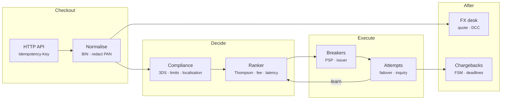

# Prism PayRoute — Architecture

Indian merchants usually connect several payment gateways, because any one of them will have bad minutes: a UPI switch slows down, a bank's ACS times out, a PSP has a partial outage. Routing every payment to the gateway most likely to succeed right now, without paying too much and without charging anyone twice, is worth whole percentage points of revenue. Prism PayRoute is a complete, tested model of that decision and everything around it.

## System diagram

## How it works

1. **Normalise** — Validate the method, currency and amount (exact minor units), look up the BIN, and redact the card number so it is never stored.
2. **Gate** — Compliance blocks, asks for 3DS/AFA, or restricts the payment to PSPs that store data in India.
3. **Rank** — Eligible PSPs are scored from a Thompson sample minus fee and latency. Breaker state and merchant rules are applied, and every row records why it was ranked or excluded.
4. **Attempt** — Try the best PSP. Success ends it, a hard decline ends it, and a soft decline fails over. A timeout triggers a status inquiry first.
5. **Learn** — Only technical outcomes update the estimates and breakers. Issuer-wide failures feed the issuer breaker, and hard declines teach nothing about the PSP.

## Design decisions

- **Learn only from what the PSP controls.** Hard declines come from the customer's bank account, and issuer-wide failures come from the bank. Neither should move a PSP's score or breaker.
- **Hierarchical priors.** A fine-grained key (PSP × method × issuer) is shrunk towards its parent (PSP × method), so sparse combinations borrow strength and dense ones speak for themselves.
- **Sample, don't argmax.** Thompson sampling keeps exploration proportional to uncertainty. A PSP that recovered after an outage gets traffic back on its own.
- **Timeouts are not failures.** A timeout means "unknown", so the router asks before it retries. The `naive-retry` baseline exists to show what happens without that step.
- **Shadow comparison.** Outcomes are a pure function of (seed, payment, PSP, attempt, incidents), so every router faces the same world, and the numbers in the simulator are a fair comparison rather than separate random runs.
- **Explainable by default.** Every plan returns one row per PSP with its estimate, sample, fee, latency, score and breaker state, or the reason it was excluded.

## Production notes

The routing logic, breakers, compliance rules, FX and dispute state machine are complete and tested. The PSPs, fees and success rates are fictional. A production deployment also needs:

- Real PSP adapters (auth, capture, refund, status inquiry, webhooks) with signature verification and per-PSP idempotency keys.
- Shared state for statistics and breakers (Redis or an in-process gossip layer) so every router instance sees the same health.
- A durable payment state machine (created → authorised → captured → settled → refunded) with an outbox, and reconciliation against PSP settlement files.
- PCI DSS scope control: a vault or network tokens so raw card numbers never reach this service, plus RBI tokenisation and data-localisation reviews by compliance counsel.
- Live FX rates with a rate-lock policy, and dispute evidence upload to each network's portal.
- Guardrails for experiments: minimum traffic per PSP for contract volumes, and an offline policy evaluation before changing weights.
